# rewdio-mcp

An MCP server that lets Claude calibrate a subwoofer + mains system on its own. Claude drives
[REW](https://www.roomeqwizard.com) (sweeps, data) and a miniDSP (mute/solo, gain, delay,
polarity, PEQ), reads every result, and keeps looping until level, timing, phase and response
targets are met. You only get asked to do physical things: move the mic, move a sub.

<p>
  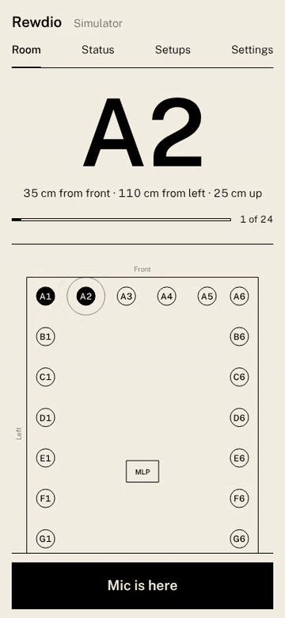
  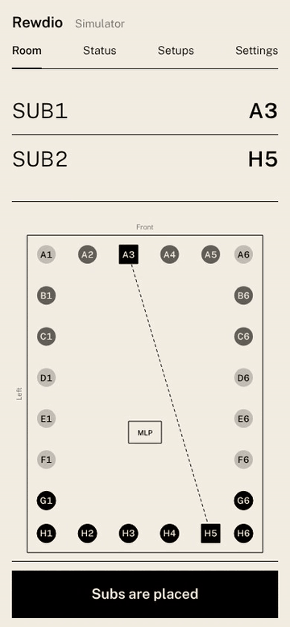
</p>

<p>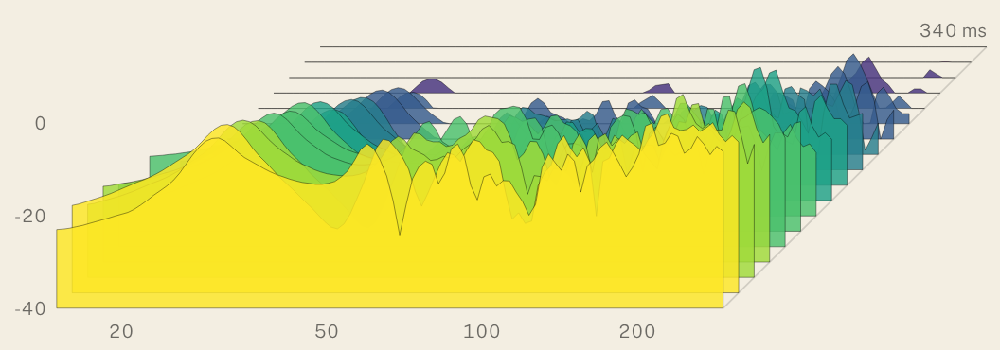</p>

## What it does

1. **Runs sweeps itself.** Configures REW's sweep, level, timing reference, protection limits and
   mic calibration (Sonarworks SoundID Reference cal file) through REW's API, gain-stages to a
   target SPL, then measures.
2. **Switches channels on and off.** Each sweep solos the speakers it needs by muting the other
   miniDSP outputs (L only, R only, each sub only, L+sub, everything).
3. **Sets delay, level and polarity on the miniDSP.** Mains are level-matched and time-aligned;
   multiple subs are integrated with each other; the sub bundle is levelled to a house curve and
   aligned to the mains through the crossover.
4. **Reverse-calculates dual-sub placement.** By acoustic reciprocity, putting the sub at the seat
   and moving the mic through candidate sub spots gives the same responses as moving the sub.
   Rewdio then ranks every pair of spots as a coherent sum with its best delay/gain/polarity.
5. **PEQ as a last resort, and light.** It is never used on the first pass: Rewdio first applies and
   verifies what gain, delay and polarity alone achieve. Only if that verified result misses the target
   is PEQ considered. It is cut-only, at most −6 dB and 3 filters, and has to earn its place. See
   "Restraint".

Every sweep passes a quality gate (SNR, clipping, dead channel, repeatability) before it can feed the
solver. Every change is predicted, applied, then verified by a real sweep. If prediction and measurement
disagree, it re-measures and re-solves. If another pass won't help, it stops and tells you what
the physical limit is (usually sub placement).

## Requirements

| Piece | Notes |
|---|---|
| Python 3.11+ and [uv](https://docs.astral.sh/uv/) | |
| **REW 5.40+ with the API enabled** | `roomeqwizard -api`, or Preferences > API. **API-triggered sweeps need a [REW Pro upgrade](https://www.roomeqwizard.com/upgrades.html).** Default `http://127.0.0.1:4735`. |
| **[minidsp-rs](https://github.com/mrene/minidsp-rs) daemon** (`minidspd`) | miniDSP has no official API; minidsp-rs is the de facto one. Rewdio talks to its HTTP API on the unix socket `/tmp/minidsp.sock` (default) or `http://127.0.0.1:5380` (enable `[http_server]` in its config). Keep the miniDSP plugin closed while calibrating so only one program is talking to the unit. |
| Measurement mic | SoundID Reference (XLR, phantom power) into your interface. Download its per-serial cal file from Sonarworks and pass it as `mic_cal_path`. |
| Recommended: loopback | A tap of the playback signal, taken *before* the miniDSP, into a second interface input, with REW's timing reference set to loopback. It gives absolute phase, 6 fewer sweeps per pass and the most reliable sub crawl. Without it, Rewdio uses **sum-fit** timing (below). See "Wiring" for how. |

Assumed signal chain: REW > DAC or interface > miniDSP analog inputs > outputs L, R, SUB1, SUB2 > amps.
Change the channel map with `configure` if yours differs.

### Wiring

**Record and play on a shared timeline.** Don't play through one USB device and record on an unrelated
one with no reference. Their clocks drift and there's no common time base, which hurts timing in every
mode. Either play and record on one interface, or keep your own DAC and add a loopback tap (below).

**With your own DAC chain** (for example USB-to-S/PDIF converter > DAC > miniDSP), add a small two-input
interface (for example a Scarlett 2i2) for recording only:

```
Computer --USB--> converter --coax--> DAC --RCA--> miniDSP --> amps
                                       |
                       left RCA via Y-splitter --> interface input 2 (line, Inst off, gain min)  <- loopback
Measurement mic --XLR--> interface input 1 (48V)
miniDSP --USB--> computer (control only, for minidsp-rs)
```

- The loopback records the DAC's real output, so the converter and DAC latency drop out. The miniDSP,
  the amps and the distance stay in the measurement; that's what gets aligned.
- On macOS, an Aggregate Device in Audio MIDI Setup (playback device plus interface, with drift
  correction on the interface) removes even the small clock mismatch. Select it in REW for input and
  output.
- S/PDIF DACs can take a moment to lock, clipping the start of a sweep. `sweep.fill_silence_with_dither`
  (on by default) keeps the stream alive, and `sweep.start_delay_s: 2` adds margin.
- Set REW, the converter and the interface to the same sample rate (48 kHz).
- In loopback mode, preflight mutes every miniDSP output, plays pink noise and checks that it arrives on
  the reference input. The room stays silent, and a missing splitter or wrong REW input is caught before
  the first sweep.
- Servo or analog sub plates (for example Rythmik): set the amp's own low-pass to bypass or its maximum,
  phase to 0, and leave all its knobs alone during a run. The miniDSP does the crossover, and Rewdio
  trims level, delay and polarity.

A ready-made config for this layout is in
[`examples/configs/dac-chain-2x4hd-loopback.json`](examples/configs/dac-chain-2x4hd-loopback.json). Copy it to
`~/.rewdio/config.json` and set `mic_cal_path`.

## Install

```bash
git clone https://github.com/montenegronyc/rewdio && cd rewdio
uv sync
```

Claude Code:

```bash
claude mcp add rewdio -- uv run --directory /path/to/rewdio-mcp rewdio-mcp
```

Claude Desktop (`claude_desktop_config.json`):

```json
{
  "mcpServers": {
    "rewdio": {
      "command": "uv",
      "args": ["run", "--directory", "/path/to/rewdio-mcp", "rewdio-mcp"]
    }
  }
}
```

### Dry run first (no hardware)

Set `REWDIO_SIMULATE=1` in the server's environment. REW and the miniDSP are replaced by a virtual
room (modal sum, two mains, two badly placed subs with unknown latency, a pre-existing crossover)
behind fake REW and minidsp-rs APIs. Claude runs the exact same loop, and your "move the mic"
confirmations move the virtual mic.

```json
"env": { "REWDIO_SIMULATE": "1" }
```

## Using it

Tell Claude something like: *"Calibrate my subs. Crossover is 80 Hz, miniDSP outputs are L, R,
SUB1, SUB2, here's my mic cal file. Do the sub placement crawl first; room is 5.8 x 4.3 x 2.6 m."*

Claude will call `configure`, then loop on `autopilot_step`. When the autopilot needs you it
returns plain instructions ("Move the mic to C3, near the floor, suggested [1.93, 3.95, 0.25] m")
and Claude relays them. After you say done, it calls `confirm_user_action` and carries on.

### Workflow

```
PREFLIGHT      REW + miniDSP checks, mic cal, timing reference, protection; DSP baseline asserted
GAIN_STAGING   ramps sweep level to the target SPL; backs off on clipping/SPL aborts
SUB_CRAWL      (optional) sub at the seat, mic through N candidate spots, ranks placements
BASELINE       every channel solo at every mic position (+ sum-fit sweeps if no loopback)
SOLVE          levels, mains alignment, sub-to-sub, subs-to-mains, optional PEQ; applied to the DSP
VERIFY         full-system sweep(s) vs prediction; converge, re-measure, or stop at a diagnosed limit
```

Typical cost with one seat, four channels, sum-fit timing and no crawl: 11 sweeps per pass (4 solo, 6
combined, 1 verify) plus a few gain-staging sweeps, 1 or 2 passes, one user action. In the simulator a full
run takes about 10 seconds of compute; on real gear it is dominated by sweep length.

### Timing: loopback vs sum-fit

Aligning subs to mains needs every measurement on one time base.

- **Loopback** (`timing_mode: "loopback"`): REW references every sweep to a wired loopback. Phase
  is absolute.
- **Sum-fit** (`timing_mode: "sum_fit"`, default): without a reference, REW puts each impulse
  peak at t=0 and absolute timing is lost. Rewdio measures `ref` alone, `X` alone and `ref+X`
  together, then fits the relative delay that reproduces the measured sum. A combined sweep only
  fixes the relative phase up to its sign, so it takes a second `ref+X` sweep with a known extra
  DSP delay on X; the true answer stays put while the mirror solution moves. Two extra sweeps per
  channel, no extra cabling.

### Reverse calculation (the sub crawl)

Put the sub **at the listening position**, driver near ear height. It doesn't go in the middle
of the room unless that's where you sit. The mic then goes to each candidate sub spot at woofer
height. If you give `room_dims_m`, Rewdio suggests spots around the perimeter. Phase handling
depends on what's available:

| Mode | When | Confidence |
|---|---|---|
| absolute | loopback timing | high |
| geometric | no loopback, but seat and spot coordinates known | medium (bulk delay from distance) |
| magnitude | neither | low (complementary peaks/nulls only) |

### Tools

| Tool | Purpose |
|---|---|
| `rewdio_status` | connectivity, config, phase, pending user action |
| `setup_status`, `save_settings`, `test_setup` | the setup wizard (see `setup` prompt) |
| `configure` | same as `save_settings` (kept for compatibility) |
| `autopilot_step` | run the loop until it needs you or finishes |
| `confirm_user_action` | report a physical task done (with optional x/y/z) |
| `get_report` | applied settings, predicted vs measured metrics, notes |
| `crawl_report` | re-rank placement candidates |
| `measure`, `analyze_measurement`, `list_measurements` | manual sweeps and summaries |
| `set_channel`, `solo`, `get_dsp_state` | direct miniDSP control |
| `set_mic_calibration` | load the mic cal file into REW |
| `list_setups`, `save_setup`, `recall_setup`, `delete_setup` | named, dated DSP setups for A/B listening |
| `reset_calibration` | start over (measurements kept) |
| `dashboard_url` | where the live dashboard is running |

Also an MCP prompt, `calibrate`, which walks the model through the loop with explicit pause points,
and three resources: `rewdio://session/report`, `rewdio://session/config` and `rewdio://session/dsp`.

### Phone remote and the crawl grid

For the sub crawl you're down on the floor with a mic, so the crawl runs from your phone.

```json
{ "do_sub_crawl": true, "room_dims_m": [5.8, 4.3, 2.6], "dashboard": { "allow_lan": true } }
```

1. Start Rewdio. Open **http://127.0.0.1:8765/** on the computer, go to **Status** and scan the pairing QR
   code with your phone. Add the page to your home screen: it runs full-screen and keeps the screen on.
2. **Mark A1** with a tape measure: 35 cm out from the front wall and 35 cm out from the left wall. Rows
   are letters going back into the room; columns are numbers going right. Every step is 75 cm, and the
   last row and column sit 35 cm from the back and right walls, so every corner is a spot.
3. The phone shows the next spot in huge letters (**C5**, with its distances from the walls). That spot
   pulses on the room plan. Put the mic there and tap **Mic is here**. Rewdio runs the sweep and the
   spot fills in: the darker it is, the better one sub there would be at your seat.
4. Tap any spot a sub can't go (sofa, doorway) to skip it.
5. At the end, the phone shows where to put the subs (**SUB1 → A3, SUB2 → H5**) as squares joined by a line.

<p>
  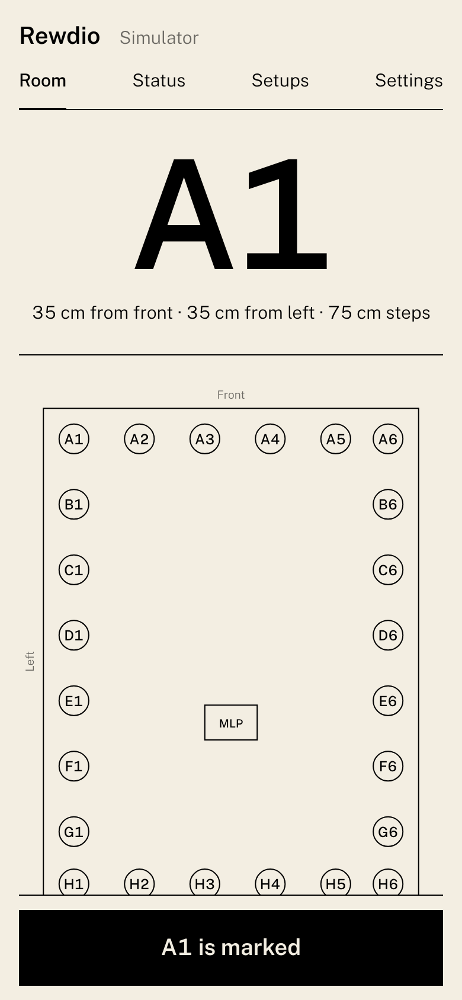
  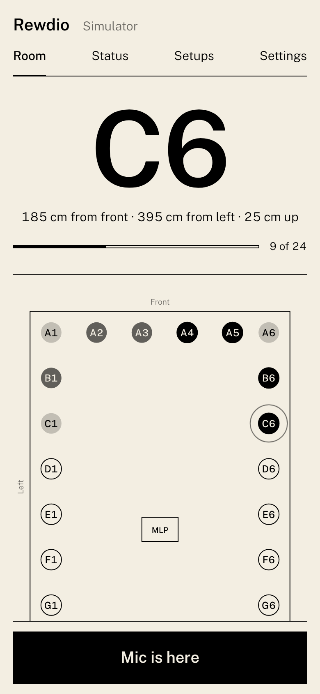
  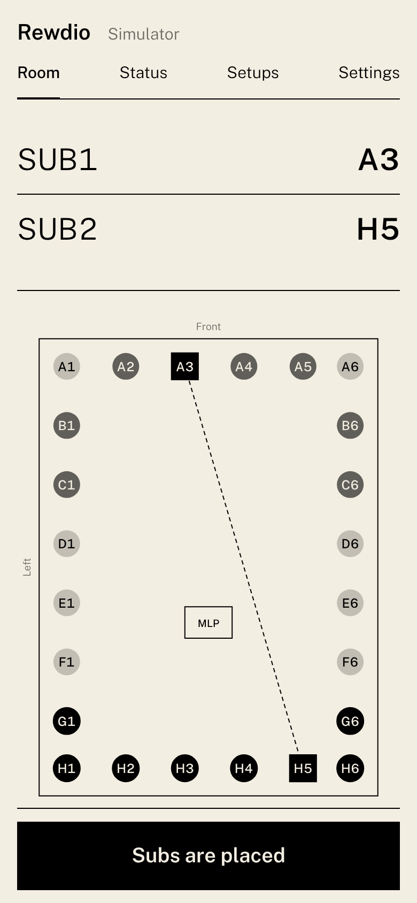
</p>

By default only the outer ring of the grid is visited (`crawl_grid.mode: "perimeter"`), because subs live
near walls. The route snakes so you walk the shortest path. Spacing, the A1 offsets, mic height and
skipped cells are under `crawl_grid` in the config.

**Pairing and safety.** These pages make your speakers play:
- Only the computer running Rewdio and devices paired by QR code can act on them.
- Network access is off until you set `dashboard.allow_lan`.
- One driver at a time: if Claude and the phone both try to advance the run, they take turns.

`rewdio-dashboard` runs the same GUI on its own, so the phone can drive a whole calibration without Claude.
The front end is React + TypeScript in `web/`. It's built into the package, so you don't need Node to run
Rewdio; run `cd web && npm install && npm run build` only if you change it.

### The GUI

One page at **http://127.0.0.1:8765/**, on the computer or a paired phone, with four tabs:
- **Room:** the crawl grid and the next spot.
- **Status:** phase, bass deviation, crossover summation, L/R balance, and measured / predicted / target
  response at each seat. Switch the chart to **Waterfall** to see how long each frequency rings after the
  sound stops: ridges that reach far back are room modes. Open the log underneath it.
- **Setups:** saved setups and the A/B switch (below).
- **Settings:** the setup wizard.

<p>
  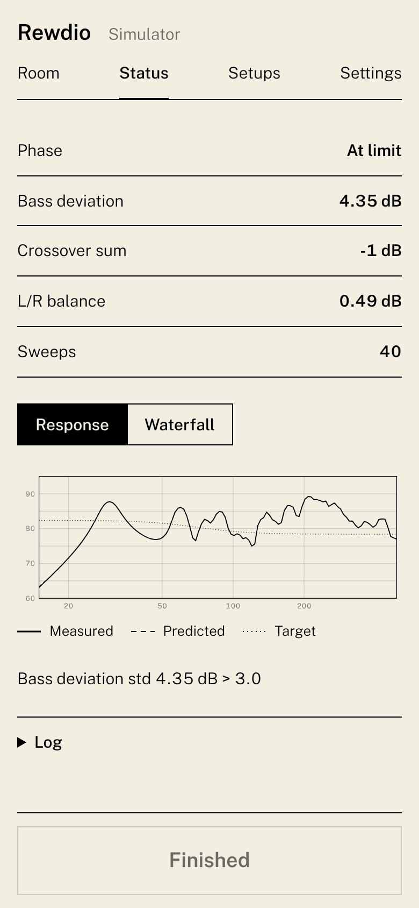
  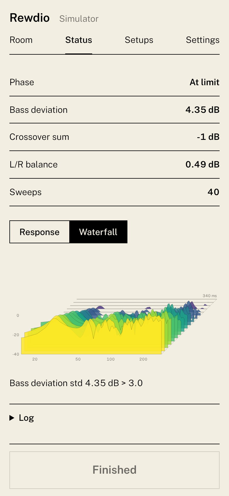
  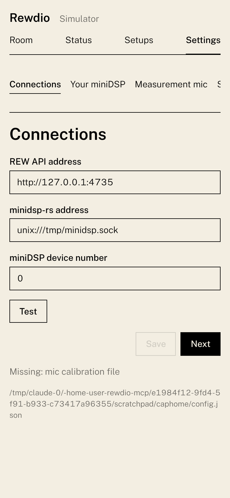
</p>

On the computer it's the same page in a browser window:

<p>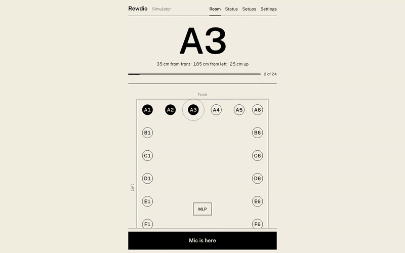</p>
<p>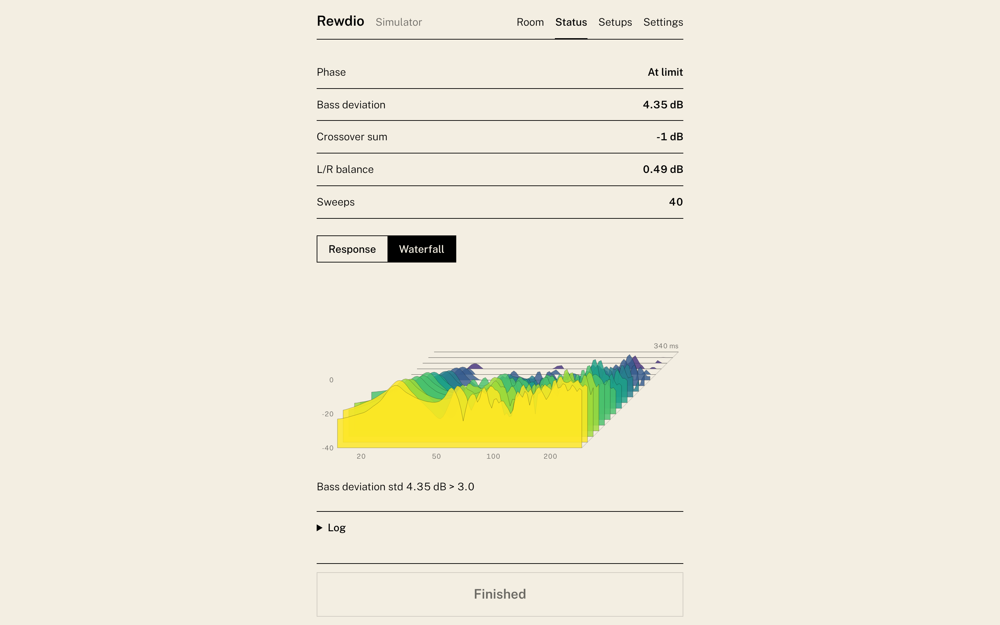</p>

The look is monochrome: cream and black, Public Sans (Light, Medium, SemiBold, bundled so it works
offline), hairline dividers and rectangular controls. Colour appears only in the waterfall, coloured by
time. Every value comes from design tokens in `src/rewdio/dashboard/tokens.json`, compiled to CSS custom
properties. Tests fail if the stylesheet contains a literal colour or a rounded corner, or if any token
outside the waterfall ramp is anything but cream or black.

The waterfall is a cumulative spectral decay. Each slice is the spectrum of a 300 ms window starting
20 ms later than the one before, taken from the impulse of the latest full-system sweep, which is kept
resampled to 2 kHz for the bass. Its span, window, step and slice count are under `dashboard.waterfall`.

### Setups and A/B listening

A setup is a snapshot of everything Rewdio manages on the miniDSP (gain, delay, polarity, PEQ on every
output), saved as a named, dated file: `~/.rewdio/setups/2026-10-23_0912_calibrated.json`. A finished
calibration saves itself as **Calibrated**. Save more candidates from the **Setups** tab or by asking
Claude ("save this as Late night, less bass").

To compare by ear, tap **A** or **B** on two setups, then tap the big A and B keys to switch. Each switch
writes the whole setup to the miniDSP in one go, with every output playing. **Blind** relabels them 1 and
2 in a random order and hides which one is active, until you tap **Reveal**.

<p>
  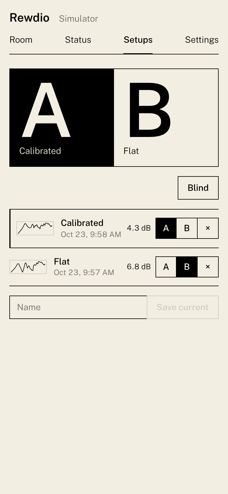
  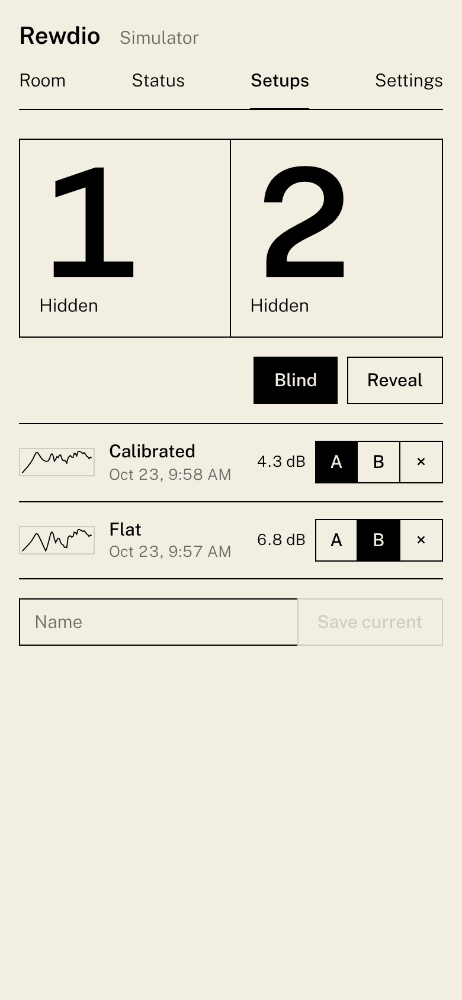
</p>

<p>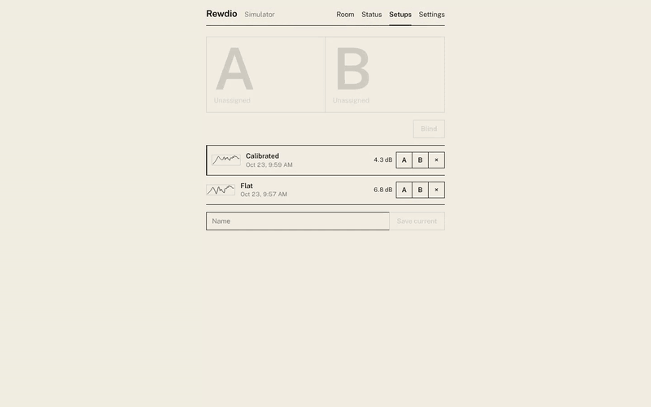</p>

Each setup carries a small response thumbnail and its bass deviation when it was swept as-is. If you
save one Claude hasn't measured, `save_setup` with `measure_first` takes one sweep first. The setup on the
miniDSP is marked by comparing files with the DSP, so the mark is always current. The folder can be moved
with `setups.dir`.

Louder usually sounds better, so keep that in mind when two setups differ in overall level.

### Restraint: as little DSP as possible

The solver works up a ladder and stops at the first rung that is good enough:

1. **Physical fixes** (sub placement via the crawl, mic positions). Diagnostics point here when the
   limit is the room.
2. **Gain, delay, polarity.** No tonal change. Changes smaller than 0.25 dB or 0.05 ms are not
   written at all, and a sub's polarity only flips when that clearly sums better than a delay.
3. **PEQ, as a last resort.** It is unlocked only after a verified pass without PEQ misses the target.
   It is then re-solved from the same, already-validated sweeps. PEQ is:
   - **cut-only** by default (`max_peq_boost_db: 0`), at most **−6 dB**, at most **3 filters**
   - fitted with a penalty on gain, so of two equally good fits the lighter one wins
   - judged only on peaks above target, because cuts cannot fill nulls and so nulls never count
     against or for a filter
   - kept per filter only if that filter improves things by at least 0.5 dB
   - **used at all only if it earns its place:** it must knock the worst peak in its band down by at
     least 3 dB, or lower the total peak excess by at least 1 dB, and never make the overall bass
     deviation worse. Otherwise it is rejected, and the log says by how much it fell short.

Every report includes a **DSP footprint**: filter count, total EQ in dB, the deepest cut, the largest
boost, inverted channels and the gain range. All thresholds live under `tuning.peq`,
`tuning.restraint` and `balance` in the config.

### Left/right balance (centre image)

Rewdio matches L and R, not just their overall level:
- It fetches each main's impulse response from REW and keeps only the **direct sound**, closing the
  gate just before the first strong reflection. Your ears localise from the first-arriving sound
  (precedence effect), so this is the balance that sets the centre image. Steady-state curves at the
  seat are dominated by reflection combs.
- Both channels use the same gate length, so neither side's level is biased.
- The louder side gets a broadband trim. What remains is fixed with up to 3 broad, low-Q filters split
  half and half (+g/2 on one side, −g/2 on the other), capped at 1.0 dB per side. The centre moves;
  the overall tone doesn't.
- It only judges what the gate can resolve. With a reflection 2.5 ms after the direct sound, that's
  above about 800 Hz. More mic positions around the seat average out reflection combs.

Settings are under `balance` in the config (band, gate limits, filter caps, and PEQ slots 7–9 on the
mains outputs). The report and dashboard show the L/R difference before and after.

### Safety and checks

- **Before any sweep.** REW's SPL and clipping protection is set and read back. The timing reference and
  mic cal are read back too. The mic input is checked for digital silence.
- **After every sweep.** It checks SNR, clipping and low-frequency coverage, and looks for a silent channel
  (amp off, cable out, wrong output). One repeat sweep checks repeatability. A critical finding stops the
  run with a fix-it instruction; the sweep is never used.
- **Cross-checks against REW itself.** Rewdio's PEQ is loaded into REW's EQ engine (miniDSP profile) and
  REW's predicted response is compared with Rewdio's maths. With loopback timing, REW's alignment tool
  gives a second opinion on sub delay. Disagreements are reported, never applied silently.
- **Diagnostics in the report.** Residual peaks are matched to room modes. Narrow nulls get
  boundary-cancellation (SBIR) hints with the implied distance. With several seats, seat-to-seat spread and
  outlier seats are reported.

### Setup wizard

You don't need to edit JSON. Use either:
- **In the browser:** the **Settings** tab at http://127.0.0.1:8765/ (on the computer, or on a paired phone).
  Nine steps:
  1. Connections, with Test buttons for REW and the miniDSP
  2. Your miniDSP model (sets the DSP sample rate)
  3. Mic calibration file (checked to exist)
  4. Which output feeds which speaker
  5. Timing (loopback or not)
  6. Room size and seats
  7. Crawl grid
  8. Crossover and target
  9. Phone access
- **In Claude:** ask it to set you up, or use the `setup` prompt. Claude walks through the same steps in
  conversation and accepts answers like "the room is about 19 by 14 feet".

Both save to your settings file (`~/.rewdio/config.json`), keeping only what differs from the defaults.
Every save is validated first, so a bad value is explained and nothing is written. Changes take effect
immediately. The steps themselves are defined in `src/rewdio/wizard.json`.

### Configuration

Every number lives in JSON; nothing is hard-coded in Python. The setup wizard writes this for you.

1. `src/rewdio/defaults.json` ships every default: rig, sweep, convergence targets, and a `tuning`
   section with every solver band, threshold, grid step and limit.
2. Your file at `~/.rewdio/config.json` (or `$REWDIO_CONFIG`) overrides any subset. A typo in a key is
   rejected, not ignored.
3. There is one settings file. Sessions store only measurements and run state, so a settings change
   applies to every session, including one already in progress.

Example `~/.rewdio/config.json`:

```json
{
  "crossover_hz": 90,
  "mic_cal_path": "C:/cal/SoundID_1234567.txt",
  "room_dims_m": [6.1, 4.2, 2.7],
  "seat_xyz": {"MLP": [3.9, 2.1, 1.1]},
  "target": {"house_curve_path": "C:/cal/my_house_curve.txt"},
  "tuning": {"peq": {"max_cut_db": 9}}
}
```

The simulator's room, speakers and DSP come from a scenario JSON
(`src/rewdio/sim/scenarios/default.json`; point `sim_scenario` at your own).

### Things to know

- minidsp-rs can't read back per-output settings, so Rewdio keeps a shadow state and **asserts a
  baseline** (gain 0, delay 0, normal polarity, unmuted) on the outputs it manages when a run
  starts. Your crossovers and any PEQ slots outside `peq_slots` (default 5-9) are left alone.
- Defaults assume a 2x4HD: 96 kHz internal rate and an 8 ms delay ceiling. Set `dsp_sample_rate`
  (48000 for SHD/2x4) and `dsp_max_delay_ms` for other units; PEQ coefficients depend on the rate.
- If the subs can't reach the target with `max_sub_gain_db` of headroom, Rewdio cuts the mains
  instead and tells you to raise the master volume.
- Long sweeps or DSD/upsampling DACs can eat the start of the sweep. Raise `sweep.start_delay_s`.
- If PEQ cuts push the subs to `max_sub_gain_db`, Rewdio lowers the mains to keep headroom and tells you.
  This can cost several dB of master volume. Raise `max_sub_gain_db` if your sub amps have headroom.
- Session state lives in `~/.rewdio/<session>` (`REWDIO_HOME`, `REWDIO_SESSION`), so a run can
  resume after a restart.

## Development

```bash
uv sync --extra dev
uv run pytest -q
```

The test suite runs full calibrations against the simulator, including the crawl, two-seat runs
and loopback mode, plus a ground-truth check that the reciprocity ranking matches actually moving
the subs. See [docs/PLAN.md](docs/PLAN.md) for the design and
[docs/COMPARISON.md](docs/COMPARISON.md) for how Rewdio compares with every other REW MCP server.
[docs/research/polycam.md](docs/research/polycam.md) evaluates importing a Polycam/RoomPlan room scan.

Every module is kept under 500 lines, and a test enforces it.

The README images are captured from the real GUI driving a simulated calibration:

```bash
uv run python docs/capture/serve.py /tmp/rewdio-capture 8799 &
node docs/capture/capture.mjs http://127.0.0.1:8799/ /tmp/rewdio-shots   # needs Playwright
sh docs/capture/gifs.sh /tmp/rewdio-shots docs/img                       # needs ffmpeg
# the desktop-window set, against a fresh serve.py
VIEWPORT=1440x900 PREFIX=mac- node docs/capture/capture.mjs http://127.0.0.1:8799/ /tmp/rewdio-shots
sh docs/capture/gifs.sh /tmp/rewdio-shots docs/img mac- 800
```

## Credits

Rewdio adopts ideas and REW wire knowledge from brandon-fryslie/room-eq-wizard-mcp, koltyj/REW-mcp,
daredoole/audio-calibration-mcp and KevinMeinon/rew-mcp-server, all MIT-licensed. See
[THIRD_PARTY_NOTICES.md](THIRD_PARTY_NOTICES.md).

## License

Copyright © 2026 Number Fortyeight Inc. All rights reserved. See [LICENSE](LICENSE).
Third-party components keep their own licences; see [THIRD_PARTY_NOTICES.md](THIRD_PARTY_NOTICES.md).
